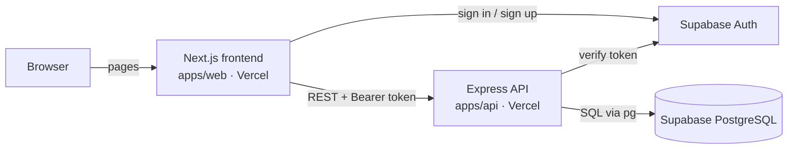
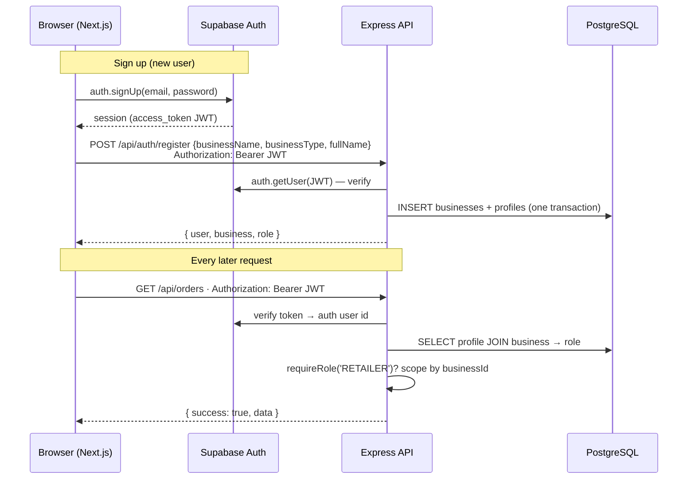

# Architecture



| Layer | Tech | Responsibility |
|---|---|---|
| Frontend | Next.js 16 (App Router), TypeScript, Tailwind CSS v4, shadcn/ui | UI only. Talks to Supabase **only for login**; all data via the API. |
| API | Node.js, Express 5, ES modules, `pg` | Business rules, permissions, SQL |
| Database | PostgreSQL on Supabase | Data + constraints. RLS blocks direct browser access. |
| Auth | Supabase Auth | Email/password accounts, JWT access tokens |

## Backend layers

```
apps/api/src/
├── app.js            Express app: CORS, JSON, routes, error handler
├── server.js         Local entry (listen). Vercel serves app.js as a function.
├── config/env.js     Reads + validates environment variables
├── db/pool.js        query() and withTransaction() helpers  ← all SQL goes through here
├── db/supabase.js    Supabase client — ONLY for verifying tokens
├── middleware/
│   ├── auth.js         requireAuth(), requireRole()
│   └── error-handler.js notFoundHandler, errorHandler
├── routes/           URL → middleware → controller   (one file per module)
├── controllers/      read req, validate, call service, sendSuccess()
├── services/         business logic + parameterized SQL
└── utils/            ApiError, sendSuccess
```

A request flows: **route → middleware (auth/role) → controller → service → `query()` → PostgreSQL**. Errors thrown anywhere end up in `errorHandler` (Express 5 catches async errors automatically).

Why plain SQL instead of an ORM? It keeps the database concepts visible (joins, transactions, constraints), which is easier to explain in a college evaluation.

## Frontend structure

```
apps/web/src/
├── app/
│   ├── page.tsx                 Landing
│   ├── (auth)/login/            Sign in / create account (Supabase Auth)
│   ├── (auth)/onboarding/       Create business after email confirmation
│   └── (app)/                   Signed-in shell: sidebar + header
│       ├── retailer/dashboard/  wholesaler/dashboard/
│       ├── products/  inventory/  orders/  analytics/
│       ├── loading.tsx  error.tsx
├── components/
│   ├── ui/                      shadcn/ui primitives (generated — avoid editing)
│   ├── layout/                  AppSidebar, AppHeader, PageHeader, ThemeToggle, BrandLogo
│   ├── states/                  LoadingState, PageSkeleton, ErrorState, EmptyState
│   ├── auth/role-guard.tsx      Hide pages from the wrong role (UX only)
│   └── module-placeholder.tsx   Temporary "who builds this" card
├── lib/
│   ├── api-client.ts            apiClient.get/post/... → unwraps { success, data }
│   ├── supabase/client.ts       Browser Supabase client (auth only)
│   ├── navigation.ts            Sidebar items + which roles see them
│   └── env.ts                   NEXT_PUBLIC_* variables
├── providers/session-provider.tsx  useSession(): role, user, status
└── types/index.ts               Role, OrderStatus, ApiResponse…
```

Design tokens (colours, radius, chart colours, brand "lume" amber) live in `apps/web/src/app/globals.css`. Use token classes (`bg-brand`, `text-muted-foreground`, `bg-card`, `text-success`…) — never hard-code hex colours.

Each module adds its own components under `src/components/<module>/` (e.g. `components/orders/`) to avoid conflicts.

## Authentication & role authorization flow



1. **Authentication (who are you?)** — `requireAuth()` verifies the Supabase JWT and loads `req.user = { id, email, fullName, businessId, businessName, role }`.
2. **Role authorization (what kind of user?)** — `requireRole('WHOLESALER')` on routes that only one role may call.
3. **Ownership authorization (is this yours?)** — in the **service**, every query is filtered by `req.user.businessId` (e.g. `where retailer_id = $1`). This is each module owner's job.
4. The frontend `RoleGuard` and role-based sidebar are **convenience only**; the API is the real gate.

In the browser, `SessionProvider` (`useSession()`) listens to Supabase's auth state, loads `GET /api/auth/me`, and exposes `status` (`loading`, `authenticated`, `onboarding`, `signed-out`, `preview`, `error`), `user`, `role`, `signIn`, `signUp`, `signOut`. `AuthGate` (in `app/(app)/layout.tsx`) sends signed-out users to `/login` and users without a business to `/onboarding`.

In development (or when Supabase isn't configured) the login page also offers a **developer preview**: pick a role and see the screens with demo data, no login. It is hidden in production builds once Supabase is configured. API calls will return `401` in preview mode — that's expected.

## Deployment

Two Vercel projects from the same GitHub repository — see [DEPLOYMENT.md](DEPLOYMENT.md).
