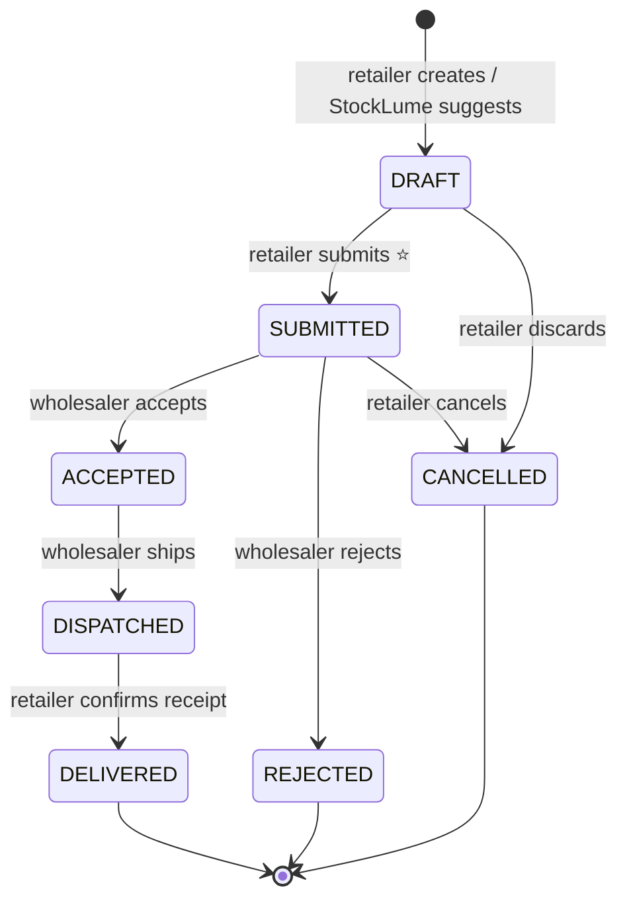

# Business rules

These rules are shared by every module. If your code disagrees with this file, either fix the code or open a PR that changes this file and tell the team.

## ⭐ The key rule

> **An order suggestion must never be sent to a wholesaler until the retailer explicitly submits it.**

What that means in practice:

1. Suggested orders are created as `DRAFT` with `is_suggested = true`.
2. While an order is `DRAFT`:
   - the wholesaler **cannot see it** — every wholesaler query on `orders` must include `status <> 'DRAFT'`;
   - **no notification** is created for the wholesaler.
3. Only `POST /api/orders/:id/submit`, called by the retailer, moves it to `SUBMITTED`, sets `submitted_at`, and creates the `ORDER_SUBMITTED` notification for the wholesaler — all in one transaction.
4. The database backs this up: the `orders_submitted_before_wholesaler_sees` constraint rejects any status except `DRAFT`/`CANCELLED` when `submitted_at` is empty.

## Order status lifecycle



| From | To | Who | Endpoint | Side effects (same transaction) |
|---|---|---|---|---|
| — | `DRAFT` | Retailer / system | `POST /orders`, `POST /orders/suggestions` | none — **no notification** |
| `DRAFT` | `DRAFT` | Retailer | `PUT /orders/:id/items` | recalculate `total_amount` |
| `DRAFT` | `SUBMITTED` | Retailer | `POST /orders/:id/submit` | `submitted_at = now()`; notify wholesaler `ORDER_SUBMITTED` |
| `DRAFT` / `SUBMITTED` | `CANCELLED` | Retailer | `POST /orders/:id/cancel` | `cancelled_at`; notify wholesaler only if it was `SUBMITTED` |
| `SUBMITTED` | `ACCEPTED` | Wholesaler | `POST /orders/:id/accept` | `accepted_at`; notify retailer `ORDER_ACCEPTED` |
| `SUBMITTED` | `REJECTED` | Wholesaler | `POST /orders/:id/reject` | `rejected_at`, `rejection_reason`; notify retailer |
| `ACCEPTED` | `DISPATCHED` | Wholesaler | `POST /orders/:id/dispatch` | `dispatched_at`; **decrease** `products.available_quantity`; `ORDER_DISPATCHED` movements; notify retailer |
| `DISPATCHED` | `DELIVERED` | Retailer | `POST /orders/:id/deliver` | `delivered_at`; **increase** retailer `inventory`; `ORDER_DELIVERED` movements; notify wholesaler |

Any other transition must return `409 CONFLICT` with code `INVALID_STATUS_TRANSITION`.

Rules for order contents:

- Every order has **one retailer and one wholesaler**. All items must be products of that wholesaler.
- The retailer must have an `ACTIVE` connection with the wholesaler.
- Items can only be added, removed or changed while the order is `DRAFT`.
- `order_items.unit_price` is copied from `products.price` when the item is added (price snapshot).
- An order needs at least one item before it can be submitted.

## Inventory update rules

Stock changes **only** through these events, and each one writes a `stock_movements` row in the **same transaction** as the quantity change:

| Event | Table updated | Change | `stock_movements.reason` | Module |
|---|---|---|---|---|
| Retailer adds a product to inventory | `inventory` | `+qty` (new row) | `INITIAL_STOCK` | Member 2 |
| Retailer records a sale | `inventory` | `−qty` | `SALE` (with `sale_id`) | Member 2 |
| Retailer corrects stock count | `inventory` | `±qty` | `MANUAL_ADJUSTMENT` | Member 2 |
| Wholesaler dispatches an order | `products.available_quantity` | `−qty` per item | `ORDER_DISPATCHED` (with `order_id`) | Member 3 |
| Retailer confirms delivery | `inventory` (upsert) | `+qty` per item | `ORDER_DELIVERED` (with `order_id`) | Member 3 |

Rules:

1. **Never go negative.** A sale larger than current stock returns `409 INSUFFICIENT_STOCK`. The `CHECK (quantity >= 0)` constraint is the safety net.
2. **Update atomically**, so two simultaneous sales cannot both succeed:
   ```sql
   update inventory
      set quantity = quantity - $3
    where business_id = $1 and product_id = $2 and quantity >= $3
   returning quantity;   -- 0 rows returned → not enough stock
   ```
3. **Delivery upserts** — if the retailer has never stocked the product, create the inventory row:
   ```sql
   insert into inventory (business_id, product_id, quantity) values ($1, $2, $3)
   on conflict (business_id, product_id) do update set quantity = inventory.quantity + excluded.quantity
   returning quantity;
   ```
4. `stock_movements` is **append-only**: never update or delete rows.
5. After a sale, check stockout risk for that product; if it becomes `HIGH`, create a `LOW_STOCK` notification (avoid duplicates: skip if an unread `LOW_STOCK` notification already exists for that product).

## Connections

- A retailer can only see products, and create orders, for wholesalers with an `ACTIVE` connection.
- A wholesaler sees every retailer with an `ACTIVE` connection to it.
- For the demo, connections may be created directly as `ACTIVE`. `PENDING` exists for a request/approve flow if time allows.

## Notifications (who gets what)

| Event | Recipient |
|---|---|
| Product becomes HIGH stockout risk | Retailer (`LOW_STOCK`) |
| Order submitted | Wholesaler (`ORDER_SUBMITTED`) — **never earlier** |
| Order accepted / rejected / dispatched | Retailer |
| Order delivered | Wholesaler |
| Order cancelled after submission | Wholesaler |

Notifications are created by the module that causes the event, using the shared helper Member 4 provides (`services/notifications.service.js → createNotification(clientOrNull, {...})`), inside the same transaction.
