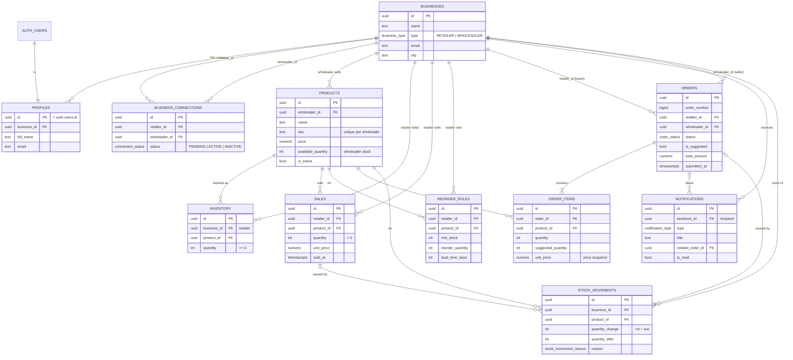

# Database

PostgreSQL hosted on Supabase. The whole schema lives in
[`supabase/migrations/20261116000000_initial_schema.sql`](../supabase/migrations/20261116000000_initial_schema.sql),
and demo data lives in [`supabase/seed.sql`](../supabase/seed.sql).

## Design principles

- **UUID primary keys** everywhere (`gen_random_uuid()`).
- **Foreign keys** for every relationship, so joins are always valid.
- **CHECK constraints** stop impossible data (negative stock, zero-quantity sales, an order "sent" without being submitted).
- **Timestamps** (`created_at`, `updated_at`) on every table; a trigger keeps `updated_at` current.
- **Enums** for fixed value lists (roles, order statuses, …).
- **Normalized**: each fact is stored once. A user's role is *not* stored on the user; it comes from their business (`businesses.type`) through a join.

## ER diagram



## Tables

| Table | Purpose | Owned by (business) | Module owner |
|---|---|---|---|
| `businesses` | A retailer or wholesaler organisation | — | Member 1 |
| `profiles` | App user, 1:1 with a Supabase Auth user, belongs to one business | business | Member 1 |
| `business_connections` | "Retailer R buys from wholesaler W" | retailer + wholesaler | Member 1 |
| `products` | Wholesaler catalogue: price + **wholesaler's** available stock | wholesaler | Member 1 |
| `inventory` | Stock a **retailer** currently holds of a product | retailer | Member 2 |
| `sales` | Retailer sales history (input to prediction) | retailer | Member 2 |
| `reorder_rules` | Per-product threshold, reorder size, lead time | retailer | Member 2 |
| `stock_movements` | Append-only log of every stock change (both roles) | either | Member 2 (writes also by Member 3) |
| `orders` | Purchase order from **one** retailer to **one** wholesaler | retailer + wholesaler | Member 3 |
| `order_items` | Lines inside an order, with a price snapshot | via order | Member 3 |
| `notifications` | Alerts for a business (low stock, order updates) | recipient business | Member 4 |

### Ownership relationships (in plain words)

- A **user** (`profiles`) belongs to exactly one **business**. Their role = `businesses.type`.
- A **wholesaler** owns many **products**. `products.available_quantity` is the wholesaler's own stock.
- A **retailer** holds **inventory** of products that come from wholesalers it is connected to.
- **Every order has exactly one retailer and exactly one wholesaler** (`orders.retailer_id`, `orders.wholesaler_id`, both `NOT NULL`). A suggestion that involves products from two wholesalers becomes **two** draft orders.
- Notifications are addressed to a **business**, so everyone in that business sees them.

### Why retailer inventory points at wholesaler products

To keep the project simple there is a single product catalogue: retailer inventory rows reference the wholesaler's `products.id`. That makes replenishment easy to explain — for any low-stock inventory row, `products.wholesaler_id` tells us exactly who to order from:

```sql
select p.name, i.quantity, r.min_stock, w.name as wholesaler
from inventory i
join products p       on p.id = i.product_id
join businesses w     on w.id = p.wholesaler_id
left join reorder_rules r on r.retailer_id = i.business_id and r.product_id = i.product_id
where i.business_id = $1
  and i.quantity <= coalesce(r.min_stock, 10)
order by i.quantity;
```

## Enums

| Enum | Values |
|---|---|
| `business_type` | `RETAILER`, `WHOLESALER` |
| `connection_status` | `PENDING`, `ACTIVE`, `INACTIVE` |
| `order_status` | `DRAFT`, `SUBMITTED`, `ACCEPTED`, `REJECTED`, `DISPATCHED`, `DELIVERED`, `CANCELLED` |
| `stock_movement_reason` | `INITIAL_STOCK`, `SALE`, `ORDER_DISPATCHED`, `ORDER_DELIVERED`, `MANUAL_ADJUSTMENT` |
| `notification_type` | `LOW_STOCK`, `CONNECTION_REQUEST`, `CONNECTION_ACCEPTED`, `ORDER_SUBMITTED`, `ORDER_ACCEPTED`, `ORDER_REJECTED`, `ORDER_DISPATCHED`, `ORDER_DELIVERED`, `ORDER_CANCELLED` |

Order statuses and transitions are explained in [BUSINESS_RULES.md](BUSINESS_RULES.md).

## Important constraints

| Constraint | What it prevents |
|---|---|
| `inventory.quantity >= 0`, `products.available_quantity >= 0` | Selling or dispatching stock you don't have |
| `orders_submitted_before_wholesaler_sees` | Any status other than `DRAFT`/`CANCELLED` without `submitted_at` set — enforces "submit before the wholesaler sees it" |
| `orders_not_self`, `business_connections_not_self` | A business ordering from / connecting to itself |
| unique `(business_id, product_id)` on `inventory` | Duplicate stock rows for one product |
| unique `(order_id, product_id)` on `order_items` | The same product twice in one order (update quantity instead) |
| unique `(wholesaler_id, sku)` on `products` | Duplicate SKUs in one catalogue |

Things the database does **not** check (the API must): that `retailer_id` really is a `RETAILER`, that a retailer is connected to the wholesaler before ordering, and that status transitions follow the lifecycle.

## Security: Row Level Security

RLS is **enabled with no policies** on every table. The Express API connects as the database owner (which bypasses RLS) and enforces permissions in code. The effect: nobody can read tables directly from the browser with the public anon key. All data goes through the API.

## Demo data (`supabase/seed.sql`)

| ID prefix | What |
|---|---|
| `11111111-…-000000000001` | FreshMart Kirana (retailer, has inventory + 30 days of sales) |
| `11111111-…-000000000002` | Daily Needs Store (retailer) |
| `22222222-…-000000000001` | Metro Wholesale Co (wholesaler) |
| `22222222-…-000000000002` | GreenLeaf Traders (wholesaler) |
| `33333333-…-00000000000N` | 8 products |

Profiles are not seeded because they must reference real Supabase Auth users. See the comment at the top of `seed.sql` to link your test user to a demo business.

## Changing the schema

**Never edit the initial migration.** Add a new file instead — see [CONTRIBUTING.md → SQL migrations](../CONTRIBUTING.md#adding-a-sql-migration).
