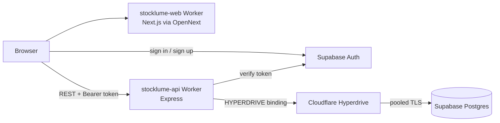

# Deployment

> Status: **live on Cloudflare Workers** with Supabase (Postgres via Hyperdrive + Auth). See the checklist at the bottom for what remains.

## 1. Supabase (database + auth)

1. Create a project at [supabase.com](https://supabase.com) (free tier is fine). Pick the region closest to your users (e.g. Mumbai `ap-south-1`).
2. **Put the connection values in `apps/api/.env`** (see step 5 for where each one is), then **apply the schema and demo data** from the repo root:
   ```bash
   npm run db:migrate     # runs every file in supabase/migrations not applied yet (tracked in stocklume_migrations)
   npm run db:seed        # loads supabase/seed.sql once (refuses to run twice)
   npm run db:migrate -- --status   # see what is applied / pending
   ```
   Already pasted the SQL into the Supabase **SQL Editor** by hand? Run `npm run db:migrate -- --baseline` once so future migrations are tracked from there. Use one method per database — don't mix in `supabase db push`.
3. **Auth** (Authentication → Sign In / Providers → Email: enabled):
   - **"Confirm email" OFF (easiest for the demo):** sign-up logs the user in immediately and creates their business.
   - **"Confirm email" ON:** sign-up shows "Check your email"; after clicking the link and signing in, the app shows a prefilled **Set up your business** page (`/onboarding`).
   - Authentication → URL Configuration: **Site URL** = `http://localhost:3000` locally (https://stocklume-web.gamingnishant2507.workers.dev in production), and add `http://localhost:3000/login` and `https://stocklume-web.gamingnishant2507.workers.dev/login` to **Redirect URLs** (used by the confirmation email).
4. **Use the demo data with a real login (optional)** — new sign-ups get their own empty business. To log in *as* a seeded demo business instead:
   - Sign up in the app (any email), copy the user's UUID from Supabase → Authentication → Users.
   - If you already completed sign-up, you own a new empty business; the SQL below moves your login to the demo business instead.
   - Run this SQL in the SQL Editor:
     ```sql
     -- To test as Retailer (FreshMart Kirana):
     insert into profiles (id, business_id, full_name, email)
     values ('<your-auth-user-uuid>', '11111111-0000-0000-0000-000000000001', 'FreshMart Owner', 'retailer@example.com')
     on conflict (id) do update set business_id = excluded.business_id;

     -- Or to test as Wholesaler (Metro Wholesale Co):
     insert into profiles (id, business_id, full_name, email)
     values ('<your-auth-user-uuid>', '22222222-0000-0000-0000-000000000001', 'Metro Manager', 'metro@example.com')
     on conflict (id) do update set business_id = excluded.business_id;
     ```
5. **Collect values:**

   | Variable | Where in Supabase |
   |---|---|
   | `SUPABASE_URL` / `NEXT_PUBLIC_SUPABASE_URL` | Project Settings → API → Project URL |
   | `SUPABASE_ANON_KEY` / `NEXT_PUBLIC_SUPABASE_ANON_KEY` | Project Settings → API → `anon` public key |
   | `DATABASE_URL` | Connect → **Transaction pooler** (port `6543`) URI, with your DB password |
   | `DATABASE_CA_CERT` | Project Settings → Database → **SSL Configuration → Download certificate** — paste the file's contents |

   **Why the CA certificate?** It lets the API check that it is really talking to Supabase (TLS certificate verification), not just that the connection is encrypted. Without it, someone between the API and Supabase could impersonate the database. When the API runs on Node in production it **refuses to start** without `DATABASE_CA_CERT`. On Cloudflare, Hyperdrive makes the TLS connection to Supabase instead (encrypted; for full certificate verification, upload the Supabase CA with `npx wrangler cert upload certificate-authority --ca-cert prod-ca-2021.crt --name supabase-ca` and recreate Hyperdrive with `--origin-ca-certificate-id <id> --sslmode verify-full`). (Escape hatch, not recommended: `DATABASE_SSL_ALLOW_UNVERIFIED=true`.) In local development it only prints a warning.

   Share these with the team privately (not in Git, not in a public chat).

## 2. Cloudflare Workers — two Workers + Hyperdrive

Live URLs (Cloudflare account of the lead):

| | URL |
|---|---|
| Frontend | https://stocklume-web.gamingnishant2507.workers.dev |
| API | https://stocklume-api.gamingnishant2507.workers.dev/api/health |



Deploy from your machine (logged in with `npx wrangler login` to the right Cloudflare account):

```bash
npm run cf:deploy --workspace @stocklume/api   # API Worker
npm run cf:deploy --workspace @stocklume/web   # builds with OpenNext, then deploys
```

### API Worker (`apps/api/wrangler.jsonc`)

- Entry `src/worker.js` runs the same Express app through Workers' Node.js compatibility (`httpServerHandler`).
- **Hyperdrive** (`stocklume-db`, binding `HYPERDRIVE`) holds the Supabase connection string (session pooler, port 5432) **as an encrypted Cloudflare secret** — the database password is never in the repo. Query caching is **disabled** so stock levels are never stale. To recreate it:
  ```bash
  npx wrangler hyperdrive create stocklume-db --connection-string="postgresql://postgres.<ref>:<password>@aws-0-<region>.pooler.supabase.com:5432/postgres" --caching-disabled
  ```
  then put the printed id in `wrangler.jsonc`.
- Vars in `wrangler.jsonc` are public values only: `SUPABASE_URL`, the publishable key, `CORS_ORIGINS` (add every frontend URL, comma-separated).
- Workers can't reuse a database socket across requests, so `DB_POOL_PER_REQUEST=true` gives each request its own small pool (max 10 connections; keep `Promise.all` batches of queries ≤ 10 per request).
- Logs: `npx wrangler tail stocklume-api` or the Cloudflare dashboard (observability is on).
- Local test of the Worker runtime: `CLOUDFLARE_HYPERDRIVE_LOCAL_CONNECTION_STRING_HYPERDRIVE=<local postgres url> npm run cf:dev --workspace @stocklume/api`.

### Frontend Worker (`apps/web/wrangler.jsonc`)

- Built with [OpenNext for Cloudflare](https://opennext.js.org/cloudflare) (`open-next.config.ts`); `next dev` / `next build` are unchanged for daily work.
- `NEXT_PUBLIC_*` values are baked in at build time — `cf:build` in `apps/web/package.json` sets the production API URL and Supabase values explicitly (so `.env.local`'s `localhost` values are never shipped). Change them there if a URL changes.
- `cacheComponents` is **off** in `next.config.ts`: the Workers runtime doesn't support it yet (pages hang). Don't turn it back on without testing `npm run cf:preview --workspace @stocklume/web`.
- `keep_names: false` in `wrangler.jsonc` avoids a `__name is not defined` error from next-themes' inline script.
- Test the production build locally before deploying: `npm run cf:preview --workspace @stocklume/web`.

## 3. Checklist (Member 4 owns this)

- [ ] Supabase project created, `npm run db:migrate` + `npm run db:seed` run against it
- [ ] Email auth enabled; "Confirm email" choice made; Site URL + Redirect URLs set
- [x] Hyperdrive created; API Worker deployed, `/api/health` shows `database: connected`
- [x] Frontend Worker deployed with production `NEXT_PUBLIC_*` values
- [x] `CORS_ORIGINS` includes the web URL
- [ ] Supabase Site URL + Redirect URLs set to the web URL
- [ ] Sign-up → register → dashboard works on production
- [ ] Demo walkthrough of all 14 flow steps on production
