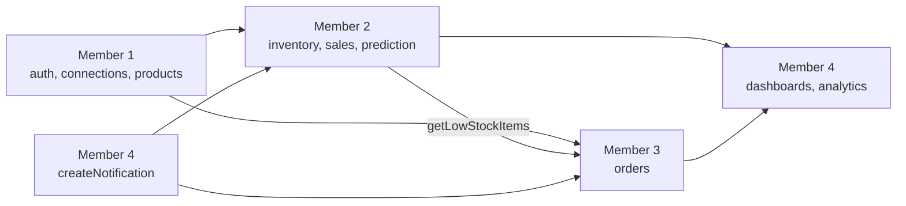

# Team modules & ownership

Each member owns **their backend APIs, SQL queries and frontend pages** for one module. Owning a file means you're the one who edits it; others open a PR or ask first.

| | Module | Branch | Owns |
|---|---|---|---|
| **Member 1** | Authentication, Connections & Products | `feature/auth-products` | Sign up/in, roles, retailer↔wholesaler connections, wholesaler product catalogue |
| **Member 2** | Inventory & Stock Prediction | `feature/inventory` | Retailer inventory, sales recording + simulation, reorder rules, stockout prediction, low-stock alerts |
| **Member 3** | Orders & Fulfillment | `feature/orders` | Suggested orders, order editing, submit, accept/reject, dispatch, delivery |
| **Member 4** | Notifications & Analytics | `feature/analytics` | Notifications, dashboards, analytics/charts, final deployment coordination |
| **Lead** | Shared foundation | `main` | Migrations review, shared files, merges |

## File map

### Member 1 — Authentication, Connections & Products

| Area | Files |
|---|---|
| API | `apps/api/src/{routes,controllers,services}/auth.*`, `connections.*`, `products.*`; `middleware/auth.js` |
| Web | `apps/web/src/app/(auth)/**`, `app/(app)/products/**`, `components/auth/**`, `components/products/**`, `components/connections/**`, `lib/supabase/**`, `providers/session-provider.tsx` |
| Tables | `businesses`, `profiles`, `business_connections`, `products` |

**First tasks**
1. Create a Supabase project (or use the team one) and enable Email auth.
2. `POST /api/auth/register` (create business + profile in one transaction) and `GET /api/auth/me`.
3. Real login/sign-up page with role choice; update `SessionProvider` to use the Supabase session + `/auth/me` (see TODOs in the file) and redirect to the role dashboard.
4. Connections endpoints + a "My wholesalers / My retailers" UI.
5. Products CRUD for wholesalers; catalogue browsing for retailers (only connected wholesalers).

### Member 2 — Inventory & Stock Prediction

| Area | Files |
|---|---|
| API | `{routes,controllers,services}/inventory.*`, `sales.*`, `predictions.*`; add `services/stockout-model.js` |
| Web | `app/(app)/inventory/**`, `components/inventory/**`, `components/sales/**` |
| Tables | `inventory`, `sales`, `reorder_rules`, `stock_movements` |

**First tasks**
1. `GET /api/inventory` joined with products + wholesaler.
2. `POST /api/sales` — insert sale, decrease stock atomically, write `SALE` movement, all in `withTransaction` ([rules](BUSINESS_RULES.md#inventory-update-rules)).
3. `POST /api/sales/simulate` for the demo.
4. Implement the [stockout model](STOCKOUT_MODEL.md) as a pure function first (easy to test), then `GET /api/predictions/stockout`.
5. Export a function Member 3 can call: `getLowStockItems(retailerId)` → items with `risk`, `suggestedQuantity`, `wholesalerId`.

### Member 3 — Orders & Fulfillment

| Area | Files |
|---|---|
| API | `{routes,controllers,services}/orders.*` |
| Web | `app/(app)/orders/**`, `components/orders/**` |
| Tables | `orders`, `order_items` (+ writes to `inventory`, `products.available_quantity`, `stock_movements` on dispatch/delivery) |

**First tasks**
1. Order status transition helper (one place that knows the allowed transitions — [lifecycle](BUSINESS_RULES.md#order-status-lifecycle)).
2. `POST /api/orders`, `PUT /api/orders/:id/items`, `GET /api/orders`, `GET /api/orders/:id`.
3. `POST /api/orders/:id/submit` ⭐ — the only place a wholesaler notification for a new order is created.
4. Wholesaler actions: accept / reject / dispatch. Retailer: cancel / deliver.
5. `POST /api/orders/suggestions` using Member 2's `getLowStockItems()` (until it exists, use the simple `quantity <= min_stock` SQL from [DATABASE.md](DATABASE.md)).

### Member 4 — Notifications & Analytics

| Area | Files |
|---|---|
| API | `{routes,controllers,services}/notifications.*`, `dashboard.*`, `analytics.*` |
| Web | `app/(app)/retailer/dashboard/**`, `app/(app)/wholesaler/dashboard/**`, `app/(app)/analytics/**`, `components/dashboard/**`, `components/analytics/**`, `components/notifications/**` |
| Tables | `notifications` (read access to everything for analytics) |

**First tasks**
1. **Do this first — others depend on it:** `createNotification(client, { businessId, type, title, message, relatedOrderId?, relatedProductId? })` in `services/notifications.service.js`. Accept an optional transaction `client` so others can call it inside their transactions.
2. Notifications endpoints + header bell with unread count.
3. Dashboard KPI endpoints and cards for both roles.
4. Analytics endpoints + charts (`npx shadcn@latest add chart` — uses Recharts and the `--chart-*` tokens).
5. Own the Vercel deployment checklist in [DEPLOYMENT.md](DEPLOYMENT.md).

### Lead — shared files

Changes to these need a heads-up in the team chat and a PR reviewed by the lead:

- `supabase/migrations/**` (new files only — never edit applied ones)
- `apps/api/src/{app.js,server.js,config/**,db/**,utils/**,middleware/error-handler.js,routes/index.js}`
- `apps/web/src/{app/layout.tsx,app/globals.css,app/(app)/layout.tsx,components/layout/**,components/states/**,lib/api-client.ts,lib/navigation.ts,types/index.ts}`
- `package.json`, `package-lock.json`, root docs

## Cross-module dependencies

To avoid blocking each other:
- Everyone can start **today** using `supabase/seed.sql` data and by testing services directly, before login exists.
- Agree on function signatures early (write them in your service file with a TODO body) and merge small PRs often.
